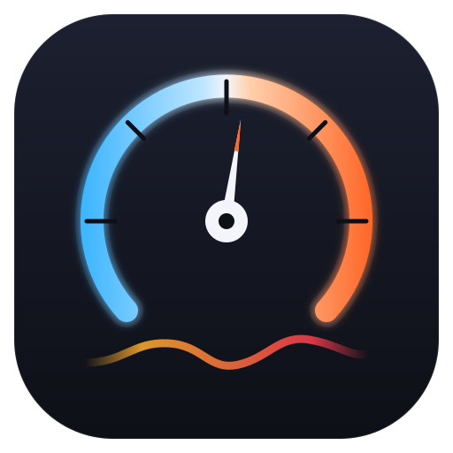
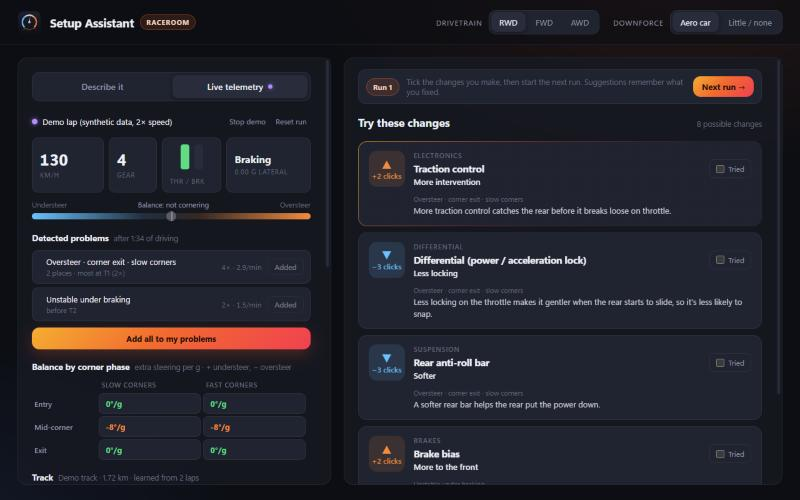

<p align="center">
  
</p>

<h1 align="center">Setup Assistant</h1>

<p align="center">
  <b>Telemetry-driven setup help for sim racers.</b><br />
  Tell it what the car does wrong (or just drive) and get ranked setup changes, each with the reason why.
</p>

<p align="center">
  
</p>

---

## What it does

Setting up a car is guesswork for most sim racers: the car understeers somewhere, you change
something, now it oversteers somewhere else. Setup Assistant turns that into a guided loop.

- **Describe the problem**: understeer, oversteer, wheelspin, lockups, unstable braking,
  bottoming, kerbs. Pick where in the corner (entry, mid, exit) and how bad. You get a ranked
  list of changes ("Front anti-roll bar, 2 clicks softer") with a plain-language reason for each.
- **Or just drive.** Live telemetry detects the problems for you: understeer and oversteer per
  corner phase, understeer under braking, lockups, wheelspin, bottoming, tyre temperature
  spreads. One click adds them to your list.
- **It remembers what you changed.** Work in runs: tick the changes you made, start the next
  run. Later suggestions avoid undoing earlier fixes and warn when a change could bring an old
  problem back, so fixing oversteer doesn't turn into chasing understeer in circles.
- **It knows the track.** The app learns each track from your laps (corners, crests,
  compressions) and tells you *where* a problem happens ("T7 The Dipper · compression").
  A problem at the same spot in every run, whatever you change, is flagged as the track rather
  than the setup.
- **In-game overlay**: a small always-on-top balance bar for single-screen setups.

## Supported games

| Game | Telemetry | Writes setup files |
|---|---|---|
| RaceRoom Racing Experience | ✅ official `$R3E` shared memory | ❌ setup files are encrypted, so you apply changes in the garage |

The core is game-agnostic; more games are on the roadmap.

## Status

Early, but usable. It works end to end with RaceRoom on Windows. The detection thresholds are
first guesses that are being tuned against real laps (see [ADR.md](ADR.md)). Expect rough edges
and changing behaviour.

## Where it's going

The full plan, with an issue per item, is in [docs/roadmap.md](docs/roadmap.md). In short:

1. **Data you can trust**: missing or stale telemetry is visible, saves survive crashes.
2. **Sessions per car and track**: history follows the car you drive, logs the clicks you
   actually made, and only calls a problem fixed after telemetry has checked it.
3. **Evidence**: detectors validated on real laps from several tracks, and every detection
   shows why it appeared. Then a **public alpha** with a Windows installer.
4. **Better tuning**: car class profiles (only adjustments your car has, real limits), run
   comparison per corner, tyre analysis.
5. **Le Mans Ultimate** as the second game.

Later: Linux (RaceRoom under Proton), in-app replay. Ideas and feedback are welcome: open an issue.

## Getting started

There are no installers yet, so you build from source (Windows, about 5 minutes the first time):

1. Install [Rust](https://rustup.rs) and the
   [Visual Studio C++ Build Tools](https://visualstudio.microsoft.com/visual-cpp-build-tools/)
   (WebView2 comes with Windows 11).
2. Clone and run:

   ```bash
   git clone https://github.com/sitzriese89/setup-assistant.git
   cd setup-assistant
   cargo run -p setup-assistant
   ```

3. Start RaceRoom and drive. Open the **Live telemetry** tab, or click **Try demo lap** to see
   it work without the game.

For the overlay, run RaceRoom in borderless or windowed mode.

## Documentation

- [CONTRIBUTING.md](CONTRIBUTING.md): developer setup, project layout, how to add rules or a game.
- [ADR.md](ADR.md): the important design decisions and why they were made.
- [docs/how-it-works.md](docs/how-it-works.md): detection, track map, runs, recordings and tuning.
- [docs/roadmap.md](docs/roadmap.md): the plan, milestones and issues.

## Data and privacy

Everything stays on your machine. The app reads the game's telemetry and saves recordings and
track maps in `%APPDATA%\dev.simracing.setupassistant`; your session (problems, runs, changes)
lives in the app's local storage. Nothing is uploaded.

## License

[MIT](LICENSE). RaceRoom is a trademark of its owners; this project isn't affiliated with or
endorsed by KW Studios / Sector3 Studios.
